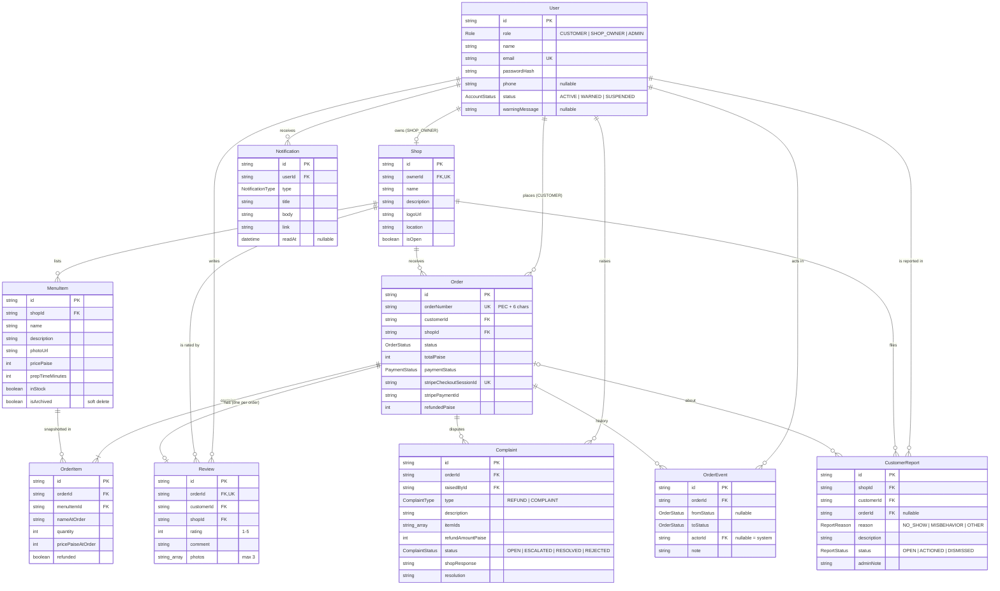
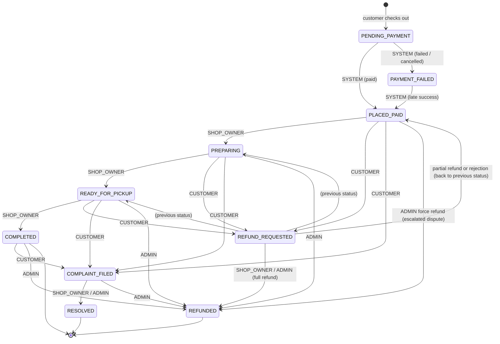
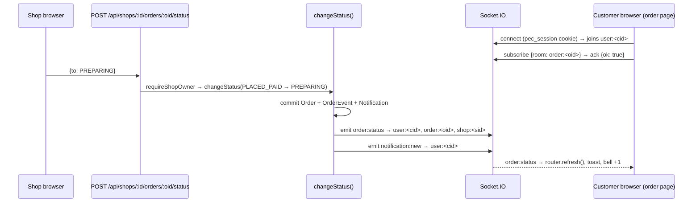

# PEC Market — Architecture

PEC Market is one Next.js (App Router, TypeScript) application. The same Node process serves the pages, the JSON API and
the Socket.IO real-time channel. PostgreSQL (via Prisma) holds all state. This document describes how the parts fit
together. The diagrams are Mermaid, and GitHub and most Markdown viewers render them.

## 1. System overview

```mermaid
flowchart LR
  subgraph Browser
    UI[React pages<br/>customer · shop · admin]
    Cart[(zustand cart<br/>localStorage)]
    SIO_C[socket.io-client]
  end
  subgraph "Node process (server.ts)"
    Proxy[src/proxy.ts<br/>role redirects]
    Pages[App Router pages<br/>src/app/(customer|shop|admin|auth)]
    API[Route handlers<br/>src/app/api/**]
    Svc[Business logic<br/>src/server/**]
    SM[order-state.ts<br/>state machine]
    IO[Socket.IO server<br/>globalThis.io]
  end
  DB[(PostgreSQL 16<br/>Prisma)]
  Store[(./uploads<br/>LocalStorageProvider)]
  Pay{{PaymentProvider<br/>Stripe or Mock}}

  UI -->|fetch JSON / multipart| API
  UI -->|navigation| Proxy --> Pages
  Pages --> Svc
  API --> Svc
  Svc --> SM
  Svc --> DB
  Svc --> Store
  Svc --> Pay
  Svc -->|emit()| IO
  IO <-->|rooms| SIO_C
  Pay -->|webhook| API
```

| Layer | Where | Responsibility |
|---|---|---|
| Custom server | `server.ts` | Hosts Next and Socket.IO on one port. Authenticates socket handshakes. Replaces `X-Forwarded-For` with the socket address (rate limiting) |
| Routing guard | `src/proxy.ts` | Page-level redirects by role. Signed-out users go to the right login page with `?next=` |
| API routes | `src/app/api/**/route.ts` | Thin: zod-parse input → call a guard → call a service → JSON. Errors are uniform (`src/server/http.ts`) |
| Guards | `src/server/auth/guards.ts` | `requireUser`, `requireRole`, `requireShopOwner(shopId)`, `requireOrderAccess(orderId)`. Suspended users are rejected and their cookie is cleared |
| Services | `src/server/**` | Checkout, payments, status changes, disputes, reviews, reports, admin actions |
| State machine | `src/lib/order-state.ts` | The only list of allowed order transitions and who may make them |
| Status changes | `src/server/orders/changeStatus.ts` | The single write path for `Order.status`: transition check → `OrderEvent` → `Notification`s → `emit()` |
| Payments | `src/server/payments/` | `PaymentProvider` interface, with `StripeProvider` and `MockProvider` selected by `PAYMENTS_PROVIDER` |
| Storage | `src/server/storage/` | `StorageProvider`; images are sniffed from their bytes, max 5 MB, and served by `/api/uploads/[...path]` |
| Real-time | `src/server/realtime/` | Handshake auth, room joins, `emit()` routing |

**Auth.** Passwords are hashed with bcrypt. Sessions are a JWT (HS256, `jose`) in the httpOnly, SameSite=Lax
cookie `pec_session`. Every API request and every portal layout re-loads the user from the database, so a suspension
takes effect on the user's next request. Failed logins are rate-limited in memory per account+IP, per account and
per IP (`src/server/auth/rate-limit.ts`).

## 2. Data model (ER diagram)

Money is stored as integer paise. Order items snapshot the dish name and price at order time.



## 3. Order state machine

The source of truth is `TRANSITIONS` in `src/lib/order-state.ts`. Each arrow is labelled with who may make that
change. `SYSTEM` means a payment confirmation (mock pay, the Stripe webhook, or the success-page check), never a
signed-in user.



Every accepted transition goes through `changeStatus()`. That function:

1. checks the transition with `checkTransition(from, to, actor, { previousStatus })` and refuses anything else with
   409 (invalid) or 403 (wrong actor);
2. updates the order conditionally (`WHERE status = from`), so a concurrent change gets 409 `ORDER_CHANGED`;
3. writes an `OrderEvent` row (from, to, actor, note) and the `Notification` rows, in the same transaction;
4. after the commit, calls `emit()` for the status change and for each notification.

## 4. Payment sequence

### Stripe (test mode)

```mermaid
sequenceDiagram
  autonumber
  actor C as Customer browser
  participant API as Next API
  participant DB as PostgreSQL
  participant S as Stripe
  participant IO as Socket.IO

  C->>API: POST /api/checkout {shopId, items[{menuItemId, qty, pricePaise}]}
  API->>DB: tx: re-check shop open, dishes in stock, prices<br/>create Order PENDING_PAYMENT + OrderItems + OrderEvent
  API->>S: checkout.sessions.create(line items, metadata.orderId,<br/>success/cancel URLs, idempotency key)
  S-->>API: session {id, url}
  API->>DB: save stripeCheckoutSessionId
  API-->>C: 201 {checkoutUrl}
  C->>S: redirect to hosted Checkout, pays (4242 4242 4242 4242)
  par Webhook
    S->>API: POST /api/payments/stripe/webhook (signed)
    API->>API: verify signature on raw body
    API->>DB: markOrderPaid() — idempotent, conditional update<br/>→ PLACED_PAID / PAID, OrderEvent, shop Notification
    API->>IO: emit order:status + notification:new → shop:<id>, user:<id>
  and Success page
    S-->>C: redirect /checkout/success?session_id=…
    C->>API: (server page) confirmCheckoutPayment(session)
    API->>S: sessions.retrieve
    API->>DB: markOrderPaid() (no-op if the webhook was first)
  end
  Note over C,API: Cancel → /checkout/cancel → PAYMENT_FAILED; the cart is kept for a retry
```

Refunds call `PaymentProvider.refund(paymentId, amountPaise, idempotencyKey)`. The request is claimed first, so a
second or concurrent approve never refunds twice. Stripe's `charge.refunded` webhook keeps `refundedPaise` in step
when a refund is made outside the app.

### Mock provider (development, E2E)

`createCheckout` returns `/pay/mock/<orderId>`. That page has **Pay** and **Fail payment** buttons, which call
`POST /api/payments/mock/<orderId>`, and those run the same `markOrderPaid()` / `markOrderPaymentFailed()` as
Stripe. Mock refunds succeed at once. The provider is chosen by `PAYMENTS_PROVIDER` (`stripe` / `mock` / `auto`).

## 5. Real-time room design

| Room | Who joins | How | Events received |
|---|---|---|---|
| `user:<userId>` | every signed-in socket | automatically at handshake | `order:status` for their orders, `notification:new` |
| `shop:<shopId>` | that shop's owner | automatically at handshake | `order:status` for the shop's orders (new paid orders included), `menu:item`, `shop:updated`, `shop:review` |
| `admin` | admins | automatically at handshake | `order:status` entering/leaving REFUND_REQUESTED / COMPLAINT_FILED, `report:changed` |
| `order:<orderId>` | the order's customer, its shop's owner (paid orders only), admins | `subscribe` message (zod-validated, acked) from the order page | `order:status` |
| `menu:<shopId>` | any signed-in user viewing a visible shop | `subscribe` message from the shop page | `menu:item` (stock / archive), `shop:updated` (open / closed), `shop:review` |



- **Handshake auth** (`src/server/realtime/server.ts`). The `pec_session` cookie is verified and the user is loaded
  as in the API guards. Anonymous, stale and suspended sockets are refused. Suspending a user disconnects their
  open sockets at once.
- **Client** (`src/lib/realtime/`, `useSocket`). One shared socket per tab, with reference-counted room
  subscriptions that are sent again after every reconnect. Pages refetch on reconnect, so missed events are never
  lost. Server-rendered pages update through `LiveRefresh` (`router.refresh()`), which coalesces bursts of events.
- **Emitting** happens only after the database transaction commits, so a client that refetches on an event always
  sees the new state.
